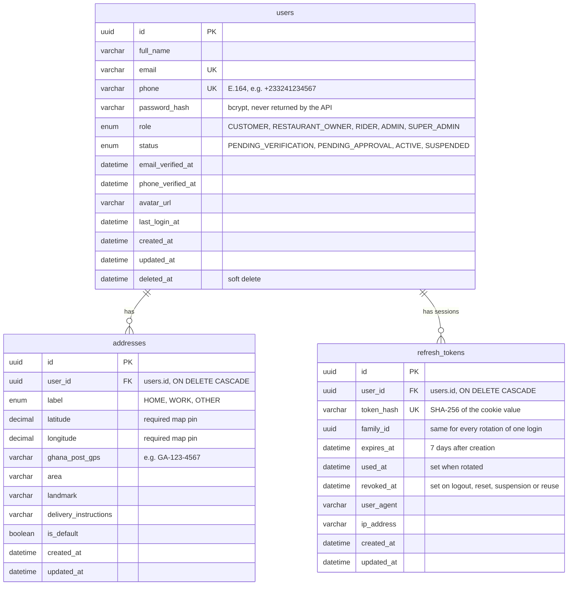

# ER Diagram

The database tables and how they connect ([AC-DB-05](../CibusHub_Acceptance_Criteria.md)). Update this file in the same commit as every new migration.

## Conventions

- Every `id` is a UUID generated by the app.
- Column names are `snake_case` in MySQL and `camelCase` in Sequelize models (`underscored: true`).
- All times are stored in UTC.
- Money columns (from Step 8) are integer pesewas.
- `deleted_at` marks soft-deleted rows (Sequelize `paranoid: true`).

## Relationships

| From | To | Type | On delete |
|---|---|---|---|
| `addresses.user_id` | `users.id` | many addresses belong to one user | CASCADE |
| `refresh_tokens.user_id` | `users.id` | many sessions belong to one user | CASCADE |
