# ER Diagram

The database tables and how they connect ([AC-DB-05](../CibusHub_Acceptance_Criteria.md)). Update this file in the same commit as every new migration.

```mermaid
erDiagram
    users ||--o{ addresses : "has"
    users ||--o{ refresh_tokens : "has sessions"
    users ||--o{ restaurants : "owns"
    users ||--o{ audit_logs : "acts (admin)"
    restaurants ||--o{ restaurant_opening_hours : "open on"
    restaurants ||--o{ restaurant_documents : "verified by"
    restaurants ||--o{ menu_categories : "has"
    restaurants ||--o{ menu_items : "sells"
    menu_categories ||--o{ menu_items : "groups"
    menu_items ||--o{ menu_option_groups : "has"
    menu_option_groups ||--o{ menu_options : "has"
    users ||--o{ orders : "places"
    restaurants ||--o{ orders : "receives"
    orders ||--|{ order_items : "contains"
    order_items ||--o{ order_item_options : "with"
    orders ||--|{ order_status_history : "moves through"
    menu_items |o--o{ order_items : "copied into"
    orders ||--o{ payments : "paid by"
    orders ||--o{ refunds : "refunded by"
    payments ||--o{ refunds : "paid back to"

    users {
        uuid id PK
        varchar full_name
        varchar email UK
        varchar phone UK "E.164, e.g. +233241234567"
        varchar password_hash "bcrypt, never returned by the API"
        enum role "CUSTOMER, RESTAURANT_OWNER, RIDER, ADMIN, SUPER_ADMIN"
        enum status "PENDING_VERIFICATION, PENDING_APPROVAL, ACTIVE, SUSPENDED"
        datetime email_verified_at
        datetime phone_verified_at
        varchar avatar_url
        datetime last_login_at
        datetime terms_accepted_at "sign-up consent (Act 843)"
        varchar terms_version "which Terms version was accepted"
        datetime created_at
        datetime updated_at
        datetime deleted_at "soft delete"
    }

    addresses {
        uuid id PK
        uuid user_id FK "users.id, ON DELETE CASCADE"
        enum label "HOME, WORK, OTHER"
        decimal latitude "required map pin"
        decimal longitude "required map pin"
        varchar ghana_post_gps "e.g. GA-123-4567"
        varchar area
        varchar landmark
        varchar delivery_instructions
        boolean is_default
        datetime created_at
        datetime updated_at
    }

    refresh_tokens {
        uuid id PK
        uuid user_id FK "users.id, ON DELETE CASCADE"
        varchar token_hash UK "SHA-256 of the cookie value"
        uuid family_id "same for every rotation of one login"
        datetime expires_at "7 days after creation"
        datetime used_at "set when rotated"
        datetime revoked_at "set on logout, reset, suspension or reuse"
        varchar user_agent
        varchar ip_address
        datetime created_at
        datetime updated_at
    }

    restaurants {
        uuid id PK
        uuid owner_id FK "users.id, ON DELETE RESTRICT"
        varchar name "FULLTEXT with description"
        varchar legal_name "never shown publicly"
        text description
        varchar phone "E.164"
        json cuisine_tags
        varchar address_line
        varchar area
        varchar city "default Kumasi"
        decimal latitude
        decimal longitude
        varchar logo_url
        varchar logo_public_id "Cloudinary ID, to delete on replace"
        varchar cover_image_url
        varchar cover_image_public_id
        enum status "PENDING_APPROVAL, APPROVED, REJECTED, SUSPENDED"
        text rejection_reason
        boolean is_accepting_orders
        int min_order_pesewas
        decimal delivery_radius_km
        int prep_time_minutes
        datetime approved_at
        datetime created_at
        datetime updated_at
        datetime deleted_at "soft delete"
    }

    restaurant_opening_hours {
        uuid id PK
        uuid restaurant_id FK "restaurants.id, ON DELETE CASCADE"
        tinyint day_of_week "0 = Sunday; unique per restaurant"
        boolean is_closed
        time opens_at "Africa/Accra"
        time closes_at "may be after midnight"
        datetime created_at
        datetime updated_at
    }

    restaurant_documents {
        uuid id PK
        uuid restaurant_id FK "restaurants.id, ON DELETE CASCADE"
        enum document_type "BUSINESS_REGISTRATION, FDA_CERTIFICATE, GHANA_CARD, OPERATING_LICENCE; unique per restaurant"
        varchar public_id "private Cloudinary asset"
        varchar format "pdf, jpg, png, webp"
        datetime created_at
        datetime updated_at
    }

    menu_categories {
        uuid id PK
        uuid restaurant_id FK "restaurants.id, ON DELETE CASCADE"
        varchar name
        int display_order
        datetime created_at
        datetime updated_at
        datetime deleted_at "soft delete"
    }

    menu_items {
        uuid id PK
        uuid restaurant_id FK "restaurants.id, ON DELETE CASCADE"
        uuid category_id FK "menu_categories.id, ON DELETE RESTRICT"
        varchar name "FULLTEXT with description"
        text description
        int price_pesewas "at least 1"
        varchar image_url
        varchar image_public_id
        json tags
        boolean is_available "sold-out switch"
        int daily_stock "null = unlimited"
        int stock_remaining
        int display_order
        datetime created_at
        datetime updated_at
        datetime deleted_at "soft delete, kept for old orders"
    }

    menu_option_groups {
        uuid id PK
        uuid menu_item_id FK "menu_items.id, ON DELETE CASCADE"
        varchar name "e.g. Protein"
        int min_select
        int max_select
        int display_order
        datetime created_at
        datetime updated_at
    }

    menu_options {
        uuid id PK
        uuid option_group_id FK "menu_option_groups.id, ON DELETE CASCADE"
        varchar name "e.g. Fried fish"
        int extra_price_pesewas
        boolean is_available
        int display_order
        datetime created_at
        datetime updated_at
    }

    audit_logs {
        uuid id PK
        uuid actor_id FK "users.id, ON DELETE RESTRICT"
        varchar action "e.g. RESTAURANT_APPROVED"
        varchar target_type "e.g. restaurant"
        uuid target_id "no FK: may point at any table"
        json before
        json after
        text reason
        varchar ip_address
        datetime created_at "append-only: never updated or deleted"
        datetime updated_at
    }

    orders {
        uuid id PK
        varchar order_number UK "e.g. CH-261008-4821"
        uuid customer_id FK "users.id, ON DELETE RESTRICT"
        uuid restaurant_id FK "restaurants.id, ON DELETE RESTRICT"
        enum status "PENDING_PAYMENT ... DELIVERED, CANCELLED"
        enum payment_method "PAYSTACK, CASH"
        enum payment_status "UNPAID, PAID, REFUNDED, PARTIALLY_REFUNDED"
        int subtotal_pesewas
        int delivery_fee_pesewas
        int service_fee_pesewas
        int discount_pesewas
        int total_pesewas
        tinyint commission_percent "frozen at placement"
        int commission_pesewas "CibusHub's share of the subtotal"
        int restaurant_earnings_pesewas "subtotal minus commission"
        int rider_earnings_pesewas "share of the delivery fee"
        int delivery_distance_meters
        json pricing_snapshot "fee formula and inputs used"
        varchar delivery_label "copied from the address"
        decimal delivery_latitude
        decimal delivery_longitude
        varchar delivery_ghana_post_gps
        varchar delivery_area
        varchar delivery_landmark
        varchar contact_phone
        varchar restaurant_note
        varchar rider_note
        varchar idempotency_key "unique with customer_id"
        varchar cancellation_reason
        datetime created_at
        datetime updated_at
    }

    order_items {
        uuid id PK
        uuid order_id FK "orders.id, ON DELETE CASCADE"
        uuid menu_item_id FK "menu_items.id, ON DELETE SET NULL"
        varchar name "frozen copy"
        int base_price_pesewas "frozen copy"
        int unit_price_pesewas "base + options"
        int quantity
        int line_total_pesewas
        datetime created_at
        datetime updated_at
    }

    order_item_options {
        uuid id PK
        uuid order_item_id FK "order_items.id, ON DELETE CASCADE"
        uuid option_id FK "menu_options.id, ON DELETE SET NULL"
        varchar group_name "frozen copy"
        varchar name "frozen copy"
        int extra_price_pesewas "frozen copy"
        datetime created_at
        datetime updated_at
    }

    order_status_history {
        uuid id PK
        uuid order_id FK "orders.id, ON DELETE CASCADE"
        enum from_status "empty on the first row"
        enum to_status
        uuid actor_user_id FK "users.id, ON DELETE SET NULL; empty for SYSTEM"
        varchar actor_role "CUSTOMER, RESTAURANT_OWNER, RIDER, ADMIN or SYSTEM"
        varchar reason
        datetime created_at
        datetime updated_at
    }

    payments {
        uuid id PK
        uuid order_id FK "orders.id, ON DELETE RESTRICT"
        enum provider "PAYSTACK"
        varchar reference UK "e.g. CH-261009-482193-9F3A1C"
        int amount_pesewas
        varchar currency "GHS"
        enum status "PENDING, SUCCESS, FAILED, ABANDONED, AMOUNT_MISMATCH"
        varchar channel "card or mobile_money"
        varchar authorization_url
        varchar access_code
        varchar provider_transaction_id
        varchar gateway_response
        datetime paid_at
        datetime created_at
        datetime updated_at
    }

    refunds {
        uuid id PK
        uuid order_id FK "orders.id, ON DELETE RESTRICT"
        uuid payment_id FK "payments.id, ON DELETE RESTRICT"
        int amount_pesewas "all refunds together never exceed the payment"
        varchar reason
        uuid initiated_by_user_id FK "users.id, ON DELETE SET NULL; empty for SYSTEM"
        varchar initiated_by_role
        enum status "PENDING, PROCESSED, FAILED"
        varchar provider_refund_id "Paystack's id once sent"
        varchar failure_reason
        datetime processed_at
        datetime created_at
        datetime updated_at
    }
```

## Conventions

- Every `id` is a UUID generated by the app.
- Column names are `snake_case` in MySQL and `camelCase` in Sequelize models (`underscored: true`).
- All times are stored in UTC.
- Money columns are integer pesewas (`*_pesewas`).
- `deleted_at` marks soft-deleted rows (Sequelize `paranoid: true`).

## Relationships

| From | To | Type | On delete |
|---|---|---|---|
| `addresses.user_id` | `users.id` | many addresses belong to one user | CASCADE |
| `refresh_tokens.user_id` | `users.id` | many sessions belong to one user | CASCADE |
| `restaurants.owner_id` | `users.id` | an owner has many restaurants | RESTRICT |
| `restaurant_opening_hours.restaurant_id` | `restaurants.id` | one row per weekday | CASCADE |
| `restaurant_documents.restaurant_id` | `restaurants.id` | one document per type | CASCADE |
| `menu_categories.restaurant_id` | `restaurants.id` | a menu has many categories | CASCADE |
| `menu_items.restaurant_id` | `restaurants.id` | kept for quick ownership checks and search | CASCADE |
| `menu_items.category_id` | `menu_categories.id` | a category holds many items | RESTRICT |
| `menu_option_groups.menu_item_id` | `menu_items.id` | an item has option groups | CASCADE |
| `menu_options.option_group_id` | `menu_option_groups.id` | a group has options | CASCADE |
| `audit_logs.actor_id` | `users.id` | the admin who acted | RESTRICT |
| `orders.customer_id` | `users.id` | a customer places many orders | RESTRICT |
| `orders.restaurant_id` | `restaurants.id` | a restaurant receives many orders | RESTRICT |
| `order_items.order_id` | `orders.id` | an order contains its items | CASCADE |
| `order_items.menu_item_id` | `menu_items.id` | pointer only; the copy is what counts | SET NULL |
| `order_item_options.order_item_id` | `order_items.id` | an item's chosen options | CASCADE |
| `order_item_options.option_id` | `menu_options.id` | pointer only | SET NULL |
| `order_status_history.order_id` | `orders.id` | every status change | CASCADE |
| `order_status_history.actor_user_id` | `users.id` | who made the change | SET NULL |
| `payments.order_id` | `orders.id` | one row per payment attempt | RESTRICT |
| `refunds.order_id` | `orders.id` | an order's refunds | RESTRICT |
| `refunds.payment_id` | `payments.id` | the payment the money goes back to | RESTRICT |
| `refunds.initiated_by_user_id` | `users.id` | who asked for it | SET NULL |
