# Order State Machine

Which status may follow which, and who may make each move ([AC-ORD-01 to AC-ORD-03, AC-ORD-07](../CibusHub_Acceptance_Criteria.md)). The rules live in one file, `server/src/utils/order/orderStateMachine.js`, and every allowed and forbidden pair is tested in `server/tests/orders/orderStateMachine.test.js`. Update all three together.

```mermaid
stateDiagram-v2
    [*] --> PENDING_PAYMENT : customer places order
    PENDING_PAYMENT --> PAID : SYSTEM (verified payment)
    PENDING_PAYMENT --> CANCELLED : CUSTOMER, ADMIN, SYSTEM (30 min unpaid)
    PAID --> ACCEPTED : RESTAURANT_OWNER
    PAID --> REJECTED : RESTAURANT_OWNER
    PAID --> CANCELLED : CUSTOMER, ADMIN, SYSTEM
    ACCEPTED --> PREPARING : RESTAURANT_OWNER
    PREPARING --> READY_FOR_PICKUP : RESTAURANT_OWNER
    READY_FOR_PICKUP --> RIDER_ASSIGNED : SYSTEM, ADMIN
    RIDER_ASSIGNED --> PICKED_UP : RIDER
    RIDER_ASSIGNED --> READY_FOR_PICKUP : RIDER, ADMIN (rider unassigned)
    PICKED_UP --> DELIVERED : RIDER (code), CUSTOMER (only after the code locked)
    ACCEPTED --> CANCELLED : ADMIN
    PREPARING --> CANCELLED : ADMIN
    READY_FOR_PICKUP --> CANCELLED : ADMIN
    RIDER_ASSIGNED --> CANCELLED : ADMIN
    PICKED_UP --> CANCELLED : ADMIN, SYSTEM (no handover after a 10-minute door wait; food returned)
    DELIVERED --> [*]
    REJECTED --> [*]
    CANCELLED --> [*]
```

## Rules

- **Not on the map:** `409 INVALID_STATUS_TRANSITION`, and the order is unchanged (AC-ORD-02).
- **On the map, wrong role:** `403 FORBIDDEN` (AC-ORD-03).
- **Wrong person with the right role** (another restaurant's owner, a rider who is not assigned): `404 NOT_FOUND`, checked by the service, not the map.
- **SUPER_ADMIN** may do everything ADMIN may.
- **Terminal:** `DELIVERED`, `REJECTED`, `CANCELLED`. Nothing follows them. Refunds are tracked separately in `payment_status` (AC-ORD-07).
- **Customers** may cancel only before the restaurant accepts (AC-CANC-01, AC-CANC-02).
- **Riders:** the search for a rider starts at `ACCEPTED`, but the order only becomes `RIDER_ASSIGNED` once it is `READY_FOR_PICKUP` **and** a rider has accepted, whichever comes second. The rider is recorded on the `deliveries` row, not by an extra order status. See [ADR 003](adr/003-delivery-assignment.md).
- **Rider unassigned before pickup** (breakdown, admin decision): `RIDER_ASSIGNED → READY_FOR_PICKUP`, by the assigned rider or an admin, always with a reason. This one move is added to the AC-ORD-03 table so the order can honestly "return to the assignment pool" (AC-ASSIGN-08); decided 2026-10-10.
- Every change writes an `order_status_history` row in the same transaction as the status update (AC-ORD-04).
